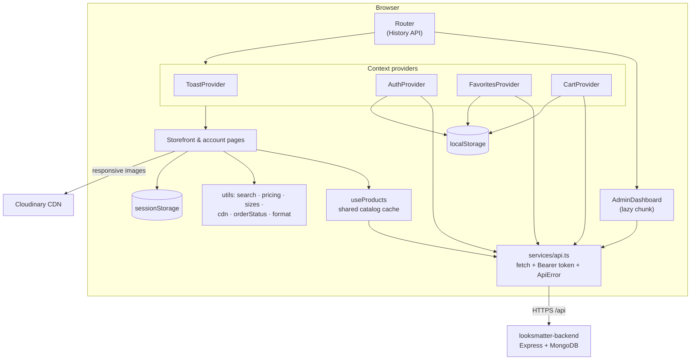
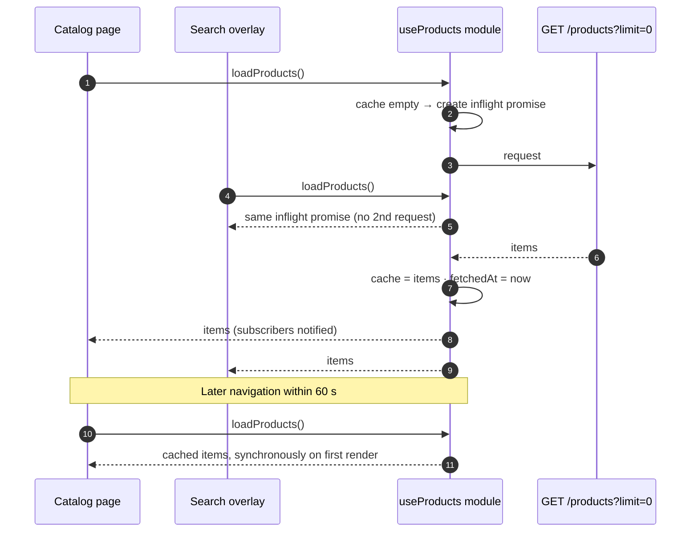
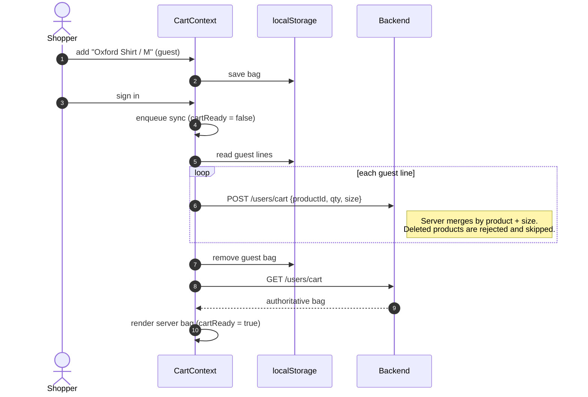
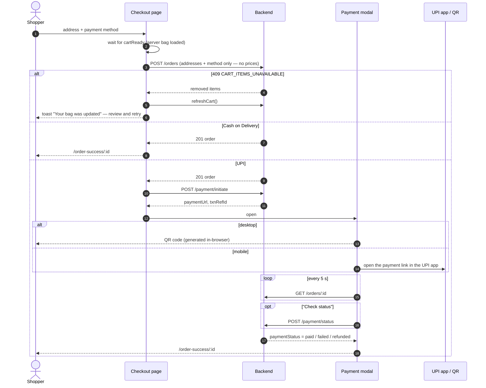
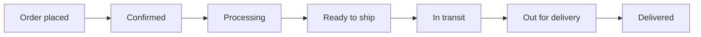
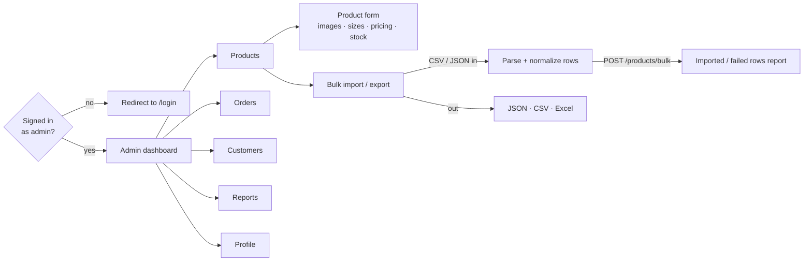

# LOOKSMATTER — Storefront & Admin UI

**A fashion e-commerce frontend in React + TypeScript: product discovery, size-aware shopping bags, checkout with UPI payments, order tracking, customer support, and a full store-operations workspace.**


LOOKSMATTER is split across two repositories:

| Repository | Role |
| --- | --- |
| **looksmatter_ui** (this repo) | Storefront, customer account, checkout, admin workspace |
| [**looksmatter-backend**](https://github.com/abuiron/looksmatter_bc) | Express + MongoDB API: auth, carts, orders, payments, authorization |

The UI aims to feel instant (shared caching, optimistic updates, preserved browsing state) while the backend stays the source of truth for prices, orders, and permissions.

---

## Contents

- [What I built](#what-i-built)
- [Features](#features)
- [Architecture](#architecture)
- [Core flows](#core-flows)
  - [Catalog cache](#1-one-shared-catalog-cache)
  - [Search](#2-search-without-a-search-service)
  - [Shareable, restorable catalog state](#3-shareable-restorable-catalog-state)
  - [Guest-to-account bag sync](#4-guest-to-account-bag-sync)
  - [Ordered cart writes](#5-ordered-cart-writes)
  - [Checkout and payment](#6-checkout-and-payment)
  - [Order tracking and support](#7-order-tracking-and-support)
  - [Admin workspace](#8-admin-workspace)
- [Performance](#performance)
- [Tech stack](#tech-stack)
- [Getting started](#getting-started)
- [Project structure](#project-structure)
- [Deployment](#deployment)
- [Known limitations and roadmap](#known-limitations-and-roadmap)

---

## What I built

| Capability | How it works | Why it matters |
| --- | --- | --- |
| **Shared catalog cache** | Module-level cache + one shared in-flight promise + subscriber set + 60 s freshness window | Pages reuse one copy of the catalog, and concurrent components never send duplicate requests |
| **Client-side search** | Normalized token matching across name, category, SKU, and description, ranked by name/category hits | `tshirt` finds "T-Shirts" without a search server |
| **Size-aware bags** | Line identity = `productId::size` | The same shirt in M and L is two lines, as shoppers expect |
| **Serialized cart sync** | A promise queue runs server cart writes one at a time, in order | Rapid `+ + −` taps can't arrive out of order and leave the server bag different from the screen |
| **Guest → account continuity** | Guest bag and favorites persist locally and merge into the account on sign-in | Shoppers can browse and save before creating an account |
| **Recoverable checkout** | Handles the API's `409 CART_ITEMS_UNAVAILABLE` by reloading the bag and explaining what changed | A product deleted mid-session leads to a review step, not a dead end |
| **URL-driven filters** | Category, search, price, discount, size, stock, and sort live in the query string | Every filtered view can be shared, bookmarked, and survives refresh |
| **Scroll + "load more" restoration** | Count and scroll position saved in `sessionStorage` per URL, restored on back navigation | Returning from a product page lands exactly where the shopper left |
| **Dual-path payment confirmation** | Polls the order (updated by the provider webhook) and offers an on-demand provider status check | A late webhook doesn't leave the shopper stuck |
| **Code-split admin** | `React.lazy` + `Suspense` for the admin dashboard | Shoppers never download admin code |
| **Responsive images** | Cloudinary URLs rewritten to `f_auto,q_auto,w_<n>` with `srcSet` | Each device downloads WebP/AVIF at a suitable width |
| **Small custom router** | ~100-line History API router with push/replace/pop awareness and modifier-click support | No router dependency, and back/forward behaviour is fully controlled |
| **Design system primitives** | Modal, Drawer, ConfirmDialog, Toast (with actions), Skeleton, EmptyState, Price, QuantityStepper, … | Consistent behaviour: Esc to close, scroll lock, `aria-modal`, loading and empty states |

---

## Features

### Storefront

- **Home** with a hero, scrolling category strip, shop-by-category grid, and featured product sections
- **Catalog** with category chips, price buckets, minimum-discount filter, size filter (apparel and footwear sizes sorted naturally), in-stock filter, and 7 sort orders. Results load 24 at a time with "load more".
- **Shop** page with a bento-style collection grid
- **Product detail** with image gallery, size picker (auto-selects one-size products), add to bag / buy now, favorites, "you may also like", and **recently viewed**
- **Search overlay** with instant ranked results as you type (`useDeferredValue` keeps typing responsive)
- **Bag** with quantity steppers, MRP vs. selling-price savings, tax and shipping preview
- **Favorites** (wishlist) for guests and signed-in shoppers

### Customer account

- Sign in / register, profile, saved shipping and billing addresses, password change
- **Checkout** in three steps (Bag → Details & payment → Confirmation) with Cash on Delivery or UPI
- **Order history** and **order detail** with a visual fulfilment timeline, payment state, delivery ETA, and pay-later QR for pending online payments
- **Cancel** an order while its payment is pending
- **Report an issue** (order or payment) with a screenshot upload, and track the report's status

### Admin workspace (`/admin`)

- **Products:** create, edit (multi-image gallery, sizes, compare-at price, stock, sale flag), delete
- **Bulk import / export:** CSV or JSON import with downloadable templates and per-row error reporting; export to JSON, CSV, or Excel
- **Orders:** filter by order id, status, and date range; update fulfilment status, payment status, and delivery date; withdraw an order with a message to the customer
- **Customers:** directory with per-customer order statistics and lifetime spend
- **Support reports:** triage by status/type, resolve or reject with admin notes
- **Profile** for the admin account

### Information pages

About, Contact, Shipping, Refund, Privacy, and Terms, built on a shared policy layout.

---

## Architecture

### Application structure



Provider order matters. `CartProvider` and `FavoritesProvider` sit **inside** `AuthProvider` because they switch between local and server storage when auth state changes. `ToastProvider` wraps everything so any layer can raise a notification.

### Where state lives

| State | Owner | Persistence |
| --- | --- | --- |
| Auth token | `ApiService` + `AuthContext` | `localStorage`; profile re-validated with `GET /users/me` on load |
| Guest bag and favorites | `CartContext`, `FavoritesContext` | `localStorage` |
| Signed-in bag and favorites | Backend (MongoDB), mirrored in context | Server, via queued API calls |
| Product catalog | `useProducts` module | In-memory, shared across pages |
| Filters, search, sort | URL query string | Shareable, survives refresh |
| "Load more" count + scroll | Catalog page | `sessionStorage`, keyed by URL |
| Recently viewed | `hooks/recentlyViewed.ts` | `localStorage` (this device, max 12) |
| Orders, payments, reports | Backend | Fetched on demand |

### Routes

| Path | Screen | Layout |
| --- | --- | --- |
| `/` | Home | Store header + footer |
| `/catalog`, `/shop` | Discovery | Store |
| `/product/:slug` | Product detail | Store |
| `/cart`, `/favorites` | Bag, wishlist | Store |
| `/login`, `/profile` | Auth, account (`?tab=orders` etc.) | Store |
| `/checkout` | Checkout | Minimal checkout header + footer |
| `/order-success/:orderId` | Order detail and tracking | Store |
| `/admin` | Admin workspace (lazy) | Standalone, no store chrome |
| `/about`, `/contact`, `/privacy`, `/terms`, `/refund`, `/shipping` | Information | Store |

---

## Core flows

### 1. One shared catalog cache

Every page that needs products calls `useProducts()`. They all share **one** cache, **one** network request, and **one** notification channel:



- Components render cached data **immediately** and don't flash skeletons on revisits.
- `retry()` forces a refresh after a failure, and an error is only shown if there is no cached copy to fall back on.
- Unmounted components unsubscribe and ignore late responses.

### 2. Search without a search service

```text
query              "tshirt black"     →  tokens ["tshirt", "black"]
product            name "Classic Tee", category "T-Shirts", description "Soft black cotton …"
haystack           "classic tee t shirts soft black cotton …"   (name + category + SKU + description, normalized)
compact haystack   "classicteetshirtssoftblackcotton…"          (spaces removed, so "tshirt" matches "T-Shirts")
match  = every token is found in the haystack OR the compact haystack   → ✓
rank   = +2 per token found in name/category                             → name hits first, description-only hits last
```

The same matcher powers the instant search overlay and the catalog's `?q=` filter.

### 3. Shareable, restorable catalog state

```text
/catalog?category=Shirts&price=1000-1999&off=30&size=M,L&stock=1&sort=price-low
```

- Each filter change uses `navigate(…, { replace: true })`, so filtering doesn't flood the back button history.
- The router records **how** you arrived (`push` / `replace` / `pop`). On `pop` (browser Back), the catalog restores the saved "load more" count and scroll position for that exact URL.
- Facet counts are computed from the current scope, so every option shows how many products it would leave.

### 4. Guest-to-account bag sync



Favorites follow the same pattern. On sign-out, the token, bag, and favorites are cleared from the device.

### 5. Ordered cart writes

The UI updates the bag **optimistically**, then sends the server write through a promise queue:

```ts
const queue = useRef<Promise<unknown>>(Promise.resolve());
const enqueue = <T,>(task: () => Promise<T>): Promise<T> => {
  const run = queue.current.then(task, task); // run after the previous write, even if it failed
  queue.current = run.catch(() => undefined);  // a failure never blocks later writes
  return run;
};
```

Without the queue, tapping `+` `+` `−` quickly could fire three concurrent requests that land in any order, leaving the **server** bag (the one that actually gets ordered) different from what the shopper sees. `refreshCart()` is queued too, so it always reflects every earlier change.

### 6. Checkout and payment



**Prices on screen are previews.** `utils/pricing.ts` mirrors the server's formula (subtotal + 0.5% tax + ₹45 shipping) for display, but the order total is always calculated by the backend from its own prices.

### 7. Order tracking and support

The order page renders the fulfilment timeline from a single status map (`utils/orderStatus.ts`):



- Pending online payments auto-refresh every 8 s and show a **pay-later QR**. Refreshing stops once the payment is final.
- Shoppers can cancel while payment is pending, or **report an issue** with a screenshot (5 MB limit, drag-and-drop).
- If an admin withdraws an order, the profile shows the reason and asks the shopper to acknowledge it.

### 8. Admin workspace



- **Import templates** document every column (required/optional, type, example). CSV export includes a UTF-8 BOM so Excel opens `₹` and non-ASCII names correctly.
- Image lists accept comma-, pipe-, or newline-separated URLs. Commas inside a URL's query string are preserved, using the same rule as the backend.
- The admin gate is a **UX** check only. Every privileged call is authorized again by the backend.

---

## Performance

Production build output at the time of writing (`npm run build`):

| Chunk | Size | Gzipped | Loaded |
| --- | --- | --- | --- |
| `index.js` (storefront) | 447 kB | **126 kB** | Always |
| `AdminDashboard.js` | 93 kB | **18 kB** | Only on `/admin` |
| `index.css` (Tailwind, purged) | 92 kB | **15 kB** | Always |

Other measures:

- `<link rel="preconnect">` to the API, Cloudinary, and Google Fonts origins
- `srcSet` + `sizes` on product imagery so phones don't download desktop-sized images
- Skeleton placeholders while the catalog loads, and cached data shown immediately on revisits
- Catalog pagination (24 per batch) keeps the DOM small on large result sets

---

## Tech stack

| Concern | Choice |
| --- | --- |
| UI | React 18 + TypeScript 5 (strict) |
| Build | Vite 5 |
| Styling | Tailwind CSS 3 + PostCSS, custom design tokens |
| Routing | Custom History API router (`utils/router.tsx`) |
| State | React Context + hooks, module-level cache |
| Networking | Typed `fetch` wrapper with bearer auth and `ApiError` (`status`, `code`, body) |
| Icons | Lucide React |
| Payments UI | `qrcode` (QR generated in the browser) |
| Images | Cloudinary on-the-fly transforms |
| Hosting | Static SPA (Netlify `_redirects` fallback) |

---

## Getting started

### Prerequisites

- Node.js 18+ and npm
- A running [looksmatter-backend](https://github.com/abuiron/looksmatter_bc) for local API work (optional; see below)

### Install and run

```sh
git clone https://github.com/abuiron/looksmatter_ui.git
cd looksmatter_ui
npm ci
cp .env.example .env.local     # point at your API (optional)
npm run dev                    # http://localhost:5173
```

### Environment

| Variable | Default | Purpose |
| --- | --- | --- |
| `VITE_API_BASE_URL` | hosted production API | Backend base URL **including** `/api`, e.g. `http://localhost:5000/api` |

Vite reads this at **build time**, so set it before `npm run build` for each environment. Payment credentials never belong here: they live only in the backend.

### Run the full stack locally

1. Start the backend on `http://localhost:5000` (see its README; `npm run seed` loads `src/data/products.json` from this repo).
2. Set `VITE_API_BASE_URL=http://localhost:5000/api` in `.env.local`.
3. `npm run dev` and open `http://localhost:5173`. This origin is already allowed by the backend's CORS configuration.

### Scripts

| Command | Purpose |
| --- | --- |
| `npm run dev` | Vite dev server with HMR |
| `npm run typecheck` | `tsc --noEmit` against the app config |
| `npm run build` | Production bundle in `dist/` |
| `npm run preview` | Serve the production build locally |
| `npm run lint` | ESLint (React Hooks + TypeScript rules) |

---

## Project structure

```text
looksmatter_ui/
├── public/
│   ├── _redirects                 # SPA fallback: /* → /index.html (200)
│   └── logo.png, icon.png
├── src/
│   ├── main.tsx                   # React entry
│   ├── App.tsx                    # Providers, route table, layouts, lazy admin
│   ├── pages/                     # Home, Catalog, Shop, ProductDetail, Cart, Favorites,
│   │                              # Auth, Profile, Checkout, OrderSuccess, AdminDashboard,
│   │                              # About, Contact, and policy pages
│   ├── components/
│   │   ├── Header.tsx, Footer.tsx, CheckoutChrome.tsx, CheckoutSteps.tsx
│   │   ├── ProductCard.tsx, ProductRail.tsx, SearchOverlay.tsx
│   │   ├── PaymentGatewayModal.tsx   # QR / UPI intent, polling, manual status check
│   │   ├── ReportIssue.tsx           # Support report form with screenshot upload
│   │   ├── PolicyLayout.tsx
│   │   ├── admin/                 # Products, ProductForm, BulkImportExport, Orders,
│   │   │                          # Users, Reports, Profile
│   │   └── ui/                    # Modal, Drawer, ConfirmDialog, EmptyState, Skeleton,
│   │                              # Price, QuantityStepper, Breadcrumbs, PageHero, …
│   ├── contexts/                  # Auth, Cart, Favorites, Toast
│   ├── hooks/                     # useProducts (shared cache), recentlyViewed,
│   │                              # useEscapeKey, useLockBodyScroll
│   ├── services/api.ts            # All HTTP calls, token handling, ApiError
│   ├── utils/
│   │   ├── router.tsx             # Router, useRouter, Link
│   │   ├── search.ts              # Tokenized, ranked product search
│   │   ├── products.ts            # Sorting, price buckets
│   │   ├── sizes.ts               # Apparel/footwear size sets and natural ordering
│   │   ├── pricing.ts             # Tax/shipping preview (mirrors the server)
│   │   ├── orderStatus.ts         # Status labels, icons, colours, timeline steps
│   │   ├── cdn.ts                 # Cloudinary resize + srcSet helpers
│   │   ├── images.ts              # Image-list parsing for admin input
│   │   └── format.ts              # INR currency, dates, discount %
│   ├── types/                     # Shared TypeScript types
│   └── data/products.json         # Seed catalog (consumed by the backend seed script)
├── .env.example
├── tailwind.config.js
└── vite.config.ts
```

---

## Deployment

```sh
npm ci
npm run typecheck
VITE_API_BASE_URL=https://your-api.example.com/api npm run build
```

Deploy `dist/` to any static host. On Netlify, `public/_redirects` makes deep links like `/product/oxford-shirt` resolve to the SPA. On other hosts, add an equivalent "rewrite all to `/index.html`" rule. Remember to add the deployed origin to the backend's CORS allowlist.

---

## Known limitations and roadmap

- **Typed API layer.** Many API responses are still typed as `any`, which is what ESLint mostly flags today. Next: shared response types (or types generated from an OpenAPI spec) for compile-time contract checks against the backend.
- **Automated tests.** Add Vitest + React Testing Library for the cart queue, guest-to-account merge, search ranking, and checkout conflict handling, and Playwright for an end-to-end purchase.
- **Cart rollback.** Optimistic cart updates log server failures but don't yet roll back or retry. Add reconciliation with the server bag after a failed write.
- **Catalog scale.** Loading the full catalog keeps filtering instant at the current size. Switch to server-side pagination and search beyond a few thousand products.
- **Session storage.** The JWT lives in `localStorage`. An httpOnly-cookie session would reduce exposure to XSS.
- **Accessibility audit.** Dialogs already use `aria-modal`, Esc-to-close, and scroll locking. Next: a full keyboard and screen-reader pass with axe.
- **Unused scaffold.** `@supabase/supabase-js` and the `supabase/` migration are left over from the initial template and aren't used by the app.

---

## Related

- **Backend API:** [abuiron/looksmatter_bc](https://github.com/abuiron/looksmatter_bc)

## Company

LOOKSMATTER CONSULTING PVT LTD · info@looksmatter.in · +91 6380280076
